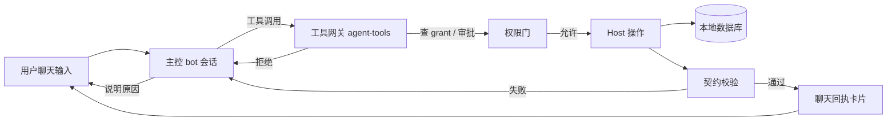

# 智能体平台（v0.2 规划）

状态：规划稿，D13 通过后进入 M5。当前 develop 只有 v0.1 能力，本文描述目标形态与边界，不代表已实现。

## 1. 目标

把“用户手动建 bot、手动搭工作流”升级为“在聊天里交办，智能体自己完成创建与编排”，并补齐平台能力（技能、模板、记忆、连接器、自动化、本地执行）。对标 Grok Bot 的团队型智能体体验，但坚持本产品的本地单机边界。

必须做到：

1. 用户在聊天框里说清需求，主控 bot 可以在授权范围内创建分组、bot、工作流并分工；
2. 每次创建/修改可预览、可撤销、有审计；
3. 能力可扩展：技能、模板、连接器（MCP）、记忆与知识；
4. 全程不引入云端账户、云电脑、计费与遥测。

## 2. 模块职责

| 模块（计划路径） | 负责 | 不负责 | 主负责人 |
| --- | --- | --- | --- |
| `packages/agent-tools/` | 工具网关：能力注册、参数校验、grant/审批检查、审计 | 业务规则、界面 | Etheslay |
| `packages/skills/` | 技能定义、校验、组合与版本 | 模型推理 | Destinyian |
| `packages/memory/` | 记忆写入、检索、删除与保留策略 | 跨设备同步 | Etheslay |
| `packages/connectors/` | MCP/连接器注册、生命周期、凭据引用 | 第三方服务实现 | Etheslay |
| `packages/exec-daemon/` | 本地执行守护、窗口截图/OCR、设备动作 | 云端执行 | Etheslay |
| `apps/desktop/src/renderer/` | 聊天内卡片、授权弹层、设置页、渲染器 | 直接读写密钥 | Destinyian |
| `packages/contracts/` | 新方法、实体、事件与版本迁移 | 业务状态 | Etheslay 主责并自审 |

现有模块边界不变：桌面主进程只经白名单 IPC 与渲染层通信，Host 持有数据库与子进程，Harness 适配层不向 UI 暴露上游对象。记忆的写入、检索和删除目前放在 `packages/storage` 与 `packages/agent-tools`，本片不新建 `packages/memory/`。`.txt` / `.md` 知识导入写进现有记忆行，不新建 `packages/memory/` 或知识表。向量检索和保留策略仍留在后续。

## 3. 数据流

原则：模型只能通过工具网关产生副作用；网关之外没有任何“后门”写入路径。

## 4. 能力分层

| 层 | 能力 | 说明 |
| --- | --- | --- |
| 读 | `list_bots` / `list_groups` / `get_workflow` / `get_run` | 让主控 bot 了解现状，默认允许 |
| 写（应用） | `create_group` / `create_bot` / `assign_bot_group` / `create_workflow` / `add_node` / `add_edge` / `update_bot` | 全部受 grant 与审批约束；批量创建 bot 时组内自动分配**不重复**的形状×颜色头像（组合用尽才允许重复），用户显式指定时以用户为准 |
| 写（执行） | `start_run` / `cancel_run` | 高风险，默认每次审批 |
| 交互 | `ask_user`（选项卡片 / 确认框） | 暂停当前回合等待人类选择；卡片答案作为用户输入回到会话；组件与 D16 授权弹层共用（见 [开发计划](DEVELOPMENT_PLAN.md) D14） |
| 搜索 | `web_search` | D15 后端通过受信配置的 SearXNG JSON API 返回标题/URL/摘要；出站前走 D08 网络权限，网关摘要审计；真实聊天接线与 D16 grant 后续完成（见 [接口说明](../packages/agent-tools/README.md)） |
| 扩展 | 技能调用、连接器调用、记忆读写 | 由技能/连接器声明所需能力 |

批量创建必须带 `batchId`，支持一键撤销整批。

## 5. 契约影响

| 变更 | 内容 | 兼容策略 |
| --- | --- | --- |
| 新方法 | `group.*`、`workflow.draft`、`tool.invoke`、`grant.*`、`memory.*`、`connector.*` | 新增方法不改旧语义；`protocolVersion` 升次版本 |
| 新实体 | `Group`、`Grant`、`Skill`、`Memory`、`Connector` | 数据库迁移带版本号，旧数据可读 |
| 新事件 | `tool.invoked`、`grant.changed`、`batch.created` | 事件只增不改，旧消费者忽略未知类型 |

契约变更走小型独立 PR，先合入 develop，再让依赖任务更新基线（见 [Git 工作流](GIT_WORKFLOW.md)）。

## 6. 安全与隐私边界

- 权限模型见 [权限与授权](PERMISSIONS.md)；默认全部“每次询问”；
- 模型不能给自己或其它 bot 授权，授权入口只对人类 UI 开放；
- 屏幕截图/OCR 默认关闭，启用后每次采集需授权，产物仅存本地；
- 连接器凭据只保存引用，明文只在使用瞬间存在；
- 撤销即时生效；批量创建可整体回滚；
- 不引入云端账户、云电脑、远程中继、计费与遥测。

## 7. 分阶段交付

| 阶段 | 任务 | 退出条件 |
| --- | --- | --- |
| M5 聊天工作台 | D14 / D15 | 聊天可渲染富文本与图表；聊天可生成创建草案（不落库） |
| M6 授权与复用 | D16 / D17 | 三档设置与会话授权生效；技能与模板可复用 |
| M7 平台能力 | D18 / D19 / D20 | 记忆、连接器、事件自动化可用且有审计 |
| M8 执行与交付 | D21 / D22 / D23 | 本地执行与屏幕感知受控可用；多语言与系统集成完成；平台验收通过 |

任务编号、负责人与依赖见 [开发计划](DEVELOPMENT_PLAN.md) §6。

## 8. 验收要点

1. 同一句需求，连续两次生成的方案结构一致（节点、连线、职责可复跑）；
2. 从聊天创建到编辑器可见 ≤ 2 次交互（含一次确认）；
3. 撤销整批创建后，数据库无残留、分组与 bot 回到创建前状态；
4. 所有写操作在审计里可查（谁授权、谁执行、改了什么）；
5. “从不允许”的能力在网关层被拒，不依赖 UI 隐藏；
6. 平台能力不得突破 v0.1 的本地边界（无云、无遥测、无远程中继）。
