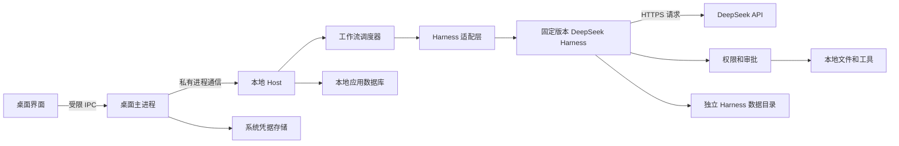

# 技术架构设计

状态：建议基线，D00 / D01 后冻结。当前没有实现。

## 1. 方案

建议 Electron + TypeScript + React 桌面应用，独立本地 Host 管理 DeepSeek Harness 和工作流。运行时复用上游受支持的 profile / SDK / 插件接口，禁止把“调用 DeepSeek Chat API 的自建循环”当成 Harness 接入。

上游已存在 Electron Desktop、Node Host 与 profile 组合机制；具体可复用程度须用 D01 验证。技术比较与替代方案见 [ADR-0001](adr/0001-desktop-and-runtime.md)。

## 2. 模块职责

| 模块（计划路径） | 负责 | 不负责 | 主负责人 |
| --- | --- | --- | --- |
| `apps/desktop/` | 窗口、托盘、安装与更新入口、受限 IPC 桥 | 模型循环、业务数据库直写 | Destinyian |
| `apps/desktop/src/renderer/` | 机器人、聊天、工作流、审批、设置界面 | 读取密钥、任意 shell 或 Node API | Destinyian |
| `packages/contracts/` | 版本化数据结构、输入校验、事件/错误契约 | 业务状态和副作用 | Etheslay 主责，双方评审 |
| `packages/runtime/` | Host 生命周期、会话与工作流编排、调度 | 绘制 UI | Etheslay |
| `packages/harness-adapter/` | 固定版本 Harness 的进程/SDK/插件适配 | 向 UI 暴露上游内部对象 | Etheslay |
| `packages/storage/` | 应用数据库、迁移、备份、查询 | 自定义修改 Harness 日志格式 | Etheslay |
| `packages/ui/` | 可复用界面与可访问性组件 | 本地数据授权判断 | Destinyian |

这些目录只描述未来布局，本次不创建应用骨架。

## 3. 数据与调用链

一次运行先验证 workflowVersion、机器人快照、路径权限与预算，再将 Run 写入本地数据库。调度器领取可执行节点，Harness 适配层建立/关联会话。流式片段只更新 UI；持久结果以 Harness 日志与本项目运行记录为准，不能把片段显示完成当作节点成功。

工具动作在执行前经过后端策略检查。审批包含动作摘要、完整参数摘要哈希、目标资源和有效期。批准后必须再次校验参数、权限和运行状态；关闭的运行或已消费审批不能再执行。

节点完成后提交输出引用和状态，再解锁后继节点。跨进程崩溃可能发生在工具执行与状态提交之间，因此仅保证状态记录和调度去重，不承诺外部副作用 exactly-once。

## 4. 本地存储

应用元数据拟使用 SQLite（事务、迁移、WAL、单 Host 写入）。Harness 原生日志保留原格式和读写入口；应用数据库保存 sessionId 和运行关联，避免两套完整聊天历史成为冲突源。

数据根目录通过操作系统应用数据 API 获取，Windows 期望位于 `%APPDATA%/DeepSeekBot/`；应用目录、用户选定工作区与程序安装目录分开。Harness 使用本应用专属 home，与用户已有 CLI 数据隔离。日志、缓存和可重新生成索引均设配额。

密钥交由系统凭据存储/操作系统加密保护，具体适配器在 D04 验证；不能安全存储时明确失败，不降级为明文。细节见[数据规范](SECURITY_DATA.md)。

## 5. 生命周期与错误

- 主进程只维护一个 Host；Host 崩溃使活跃运行进入 interrupted，UI 显示可恢复措施。
- 取消先停止新节点，通知 Harness 取消，再清理本次运行拥有的工具子进程。不能误杀用户独立进程。
- 超时、认证失败、限流、磁盘不足、权限拒绝、依赖缺失分别使用稳定错误码。
- Host 默认不开放公网服务；优先私有 IPC。必须使用回环端口时绑定 127.0.0.1、随机端口、每次启动认证凭证并校验来源。
- MCP 子进程随授权与生命周期管理；项目文件不能悄悄新增工具授权。
- 默认关闭非必要遥测、崩溃上传和隐式自动联网更新；验证上游默认配置不能仅靠 UI 开关。

## 6. 工作流一致性

工作流是有向无环图。保存时校验环、悬空引用、端口类型与预算；执行前再次验证。并发上限默认 2，可配置上限须在压力测试后确定；同一文件写目标与桌面交互工具使用资源锁。

状态机、失败后的后继处理、重试、人工确认、调度去重均以[接口契约](CONTRACTS.md)为准。工作流版本与机器人配置在运行开始时形成不可变快照，执行中修改不影响已有运行。

## 7. 需要技术验证的边界

Node 与 Electron ABI、Harness SDK 的取消/审批能力、Windows 工具进程回收、密钥存储、插件白名单和离线打包必须实测。上游 experimental Agent Teams 仅作为可选研究，不作为 v0.1 的关键依赖。本项目工作流编排不依赖实验团队功能。
