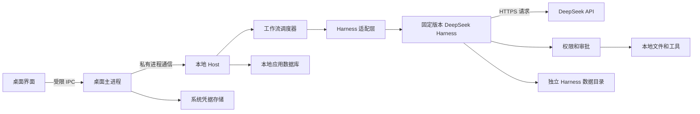

# 技术架构设计

状态：建议基线，D00 / D01 后冻结。当前没有实现。

## 1. 方案

建议 Electron + TypeScript + React 桌面应用，独立本地 Host 管理 DeepSeek Harness 和工作流。运行时复用上游受支持的 profile / SDK / 插件接口，禁止把“调用 DeepSeek Chat API 的自建循环”当成 Harness 接入。

上游已存在 Electron Desktop、Node Host 与 profile 组合机制；具体可复用程度须用 D01 验证。技术比较与替代方案见 [ADR-0001](adr/0001-desktop-and-runtime.md)。

## 2. 模块职责

| 模块（计划路径） | 负责 | 不负责 | 主负责人 |
| --- | --- | --- | --- |
| `apps/desktop/` | 窗口、托盘、安装与更新入口、受限 IPC 桥 | 模型循环、业务数据库直写 | Destinyian |
| `apps/desktop/src/renderer/` | 机器人、聊天、工作流、审批、设置界面 | 读取密钥、任意 shell 或 Node API | Destinyian |
| `packages/contracts/` | 版本化数据结构、输入校验、事件/错误契约 | 业务状态和副作用 | Etheslay 主责并自审 |
| `packages/runtime/` | Host 生命周期、会话与工作流编排、调度 | 绘制 UI | Etheslay |
| `packages/harness-adapter/` | 固定版本 Harness 的进程/SDK/插件适配 | 向 UI 暴露上游内部对象 | Etheslay |
| `packages/harness-bridge/` | 挂入 Harness profile 的审批桥插件（approval/request → D08 门） | 独立发起任何工具执行 | Etheslay |
| `packages/host/` | Host 进程组装与 stdio 服务、契约方法面、凭据通道 | 密钥解密（由桌面 main 经反向请求完成）、绘制 UI | Etheslay |
| `packages/storage/` | 应用数据库、迁移、备份、查询 | 自定义修改 Harness 日志格式 | Etheslay |
| `packages/ui/` | 可复用界面与可访问性组件 | 本地数据授权判断 | Destinyian |

桌面壳（D02）、共享契约（D03）、本地存储（D04）、工作流引擎（D06，`packages/runtime/`，经 `NodeExecutor` 端口与 Harness 适配层解耦）、后端工具权限层（D08，`packages/runtime/src/permissions/`：路径规范化/包含校验、策略评估、一次性审批门、MCP 授权检查；storage 增加 `tool_policies` 表与启动代次）与本地调度器（D10，`packages/runtime/src/scheduler/`：时区感知 cron 触发、occurrence 去重、skip-and-notify misfire、恢复重启中断的运行；storage 增加 `schedule_misses` 表与节点输出持久化）已按此布局落地；D12 起 `packages/harness-adapter/`（钉扎上游 `@deepseek-ai/dsh` 0.2.1-rc.2：一次节点尝试一个运行时子进程、经上游 JSON-RPC 行传输做回合结算、稳定错误分类）、`packages/harness-bridge/`（挂入 profile 应答 `approval/request`，回读会话日志取精确参数，无 Host 通道时 fail-closed）与 `packages/host/`（单进程组装数据库+引擎+调度器+适配器，经 stdio 暴露契约方法面；桌面 main 拉起并经反向请求完成凭据解密）已落地，QA-05/QA-09 的编排回归经假 Harness 全链自动化，真实 API 腿与睡眠唤醒联调属 D12 收尾；`packages/ui/` 仍是规划，本次不创建。主进程不得 import `packages/storage`（其索引进口拉 `node:sqlite`，Electron 38 主进程的 Node 22 不提供）——数据根与凭据 blob 读取在 main 侧按 layout 常量最小复刻。

v0.2 计划新增 `packages/agent-tools/`（工具网关）、`packages/skills/`、`packages/memory/`、`packages/connectors/` 与 `packages/exec-daemon/`，边界与契约影响见 [智能体平台](AGENT_PLATFORM.md) 与 [权限与授权](PERMISSIONS.md)；在 D13 通过前不创建这些目录。

## 3. 数据与调用链

一次运行先验证 workflowVersion、机器人快照、路径权限与预算，再将 Run 写入本地数据库。调度器领取可执行节点，Harness 适配层建立/关联会话。流式片段只更新 UI；持久结果以 Harness 日志与本项目运行记录为准，不能把片段显示完成当作节点成功。

工具动作在执行前经过后端策略检查（D08 已实现，位于 `packages/runtime/src/permissions/`）：适配层经 `NodeExecutor` 上下文拿到的权限句柄必须对每个副作用动作调用 `authorize` —— 先发 `tool.requested`（精确参数）再评估钉扎策略（policy 操作 × workspace 授权 × 产物目录；shell 仅审批放行；MCP 按服务器+工具白名单），放行、以稳定错误码拒绝或转一次性审批。审批包含动作摘要、完整参数摘要哈希（`actionDigest`，决定时必须回传校验）、目标资源和有效期（默认 10 分钟），并绑定宿主启动代次（storage `incrementBootGeneration`），重启后旧审批不能被决定或消费。批准后必须再次校验参数、权限和运行状态；关闭的运行或已消费审批不能再执行。

节点完成后提交输出引用和状态，再解锁后继节点。跨进程崩溃可能发生在工具执行与状态提交之间，因此仅保证状态记录和调度去重，不承诺外部副作用 exactly-once。

## 4. 本地存储

应用元数据使用 SQLite（`node:sqlite`，Node ≥ 24：事务、迁移、WAL、单 Host 写入）；实现位于 `packages/storage`（D04 起，含迁移、备份、恢复与数据目录布局）。Harness 原生日志保留原格式和读写入口；应用数据库保存 sessionId 和运行关联，避免两套完整聊天历史成为冲突源。注意 Electron 38 主进程内置 Node 22 无 `node:sqlite`（已实测），本包只可在独立 Node 24 Host 进程内运行。

数据根目录通过操作系统应用数据 API 获取，Windows 期望位于 `%APPDATA%/DeepSeekBot/`；应用目录、用户选定工作区与程序安装目录分开。Harness 使用本应用专属 home（`DSH_HOME`，D01 §5.1 已验证可整体迁移），与用户已有 CLI 数据隔离。日志、缓存和可重新生成索引均设配额。

密钥交由系统凭据存储/操作系统加密保护：Windows 上桌面主进程用 Electron `safeStorage`（DPAPI，D04 实测）加密后交由 `packages/storage` 以密文 blob 落盘，数据库只保存 `cred:<uuid>` 引用；不能安全存储时明确失败，不降级为明文。细节见[数据规范](SECURITY_DATA.md)。

## 5. 生命周期与错误

- 主进程只维护一个 Host；Host 崩溃使活跃运行进入 interrupted，UI 显示可恢复措施。
- 取消先停止新节点，通知 Harness 取消，再清理本次运行拥有的工具子进程。不能误杀用户独立进程。
- 超时、认证失败、限流、磁盘不足、权限拒绝、依赖缺失分别使用稳定错误码。
- Host 默认不开放公网服务；优先私有 IPC。必须使用回环端口时绑定 127.0.0.1、随机端口、每次启动认证凭证并校验来源。
- MCP 子进程随授权与生命周期管理；项目文件不能悄悄新增工具授权。
- 默认关闭非必要遥测、崩溃上传和隐式自动联网更新；验证上游默认配置不能仅靠 UI 开关。

## 6. 工作流一致性

工作流是有向无环图。保存时校验环、悬空引用、端口类型与预算；执行前再次验证。并发上限默认 2，可配置上限须在压力测试后确定；同一文件写目标与桌面交互工具使用资源锁。

状态机、失败后的后继处理、重试、人工确认、调度去重均以[接口契约](CONTRACTS.md)为准。D06 起可执行实现位于 `packages/runtime/`：stop-descendants 失败传播、有界重试（指数退避 + Retry-After）、两阶段取消与 `recoverInterruptedRuns` 已按契约状态机落地。D10 补齐调度与恢复：宿主运行期间（应用打开或驻留托盘）按各 schedule 的 IANA 时区计算 cron 触发时刻；同一 (scheduleId, occurrenceUtc) 由 runs 唯一索引保证至多一个 Run（触发后崩溃重放为 duplicate）；错过时刻超过宽限窗按 skip-and-notify 逐条登记 `schedule_misses` 并推进到下一未来时刻，不批量静默补跑（FR-08/QA-10）；`engine.resumeRun` 以新 Run 关联 `resumedFromRunId` 恢复重启中断的运行，已成功节点携带会话与输出不再重复执行。工作流版本与机器人配置在运行开始时形成不可变快照，执行中修改不影响已有运行。

## 7. 需要技术验证的边界

Node 与 Electron ABI、Harness SDK 的取消/审批能力、Windows 工具进程回收、密钥存储、插件白名单和离线打包必须实测。上游 experimental Agent Teams 仅作为可选研究，不作为 v0.1 的关键依赖。本项目工作流编排不依赖实验团队功能。

