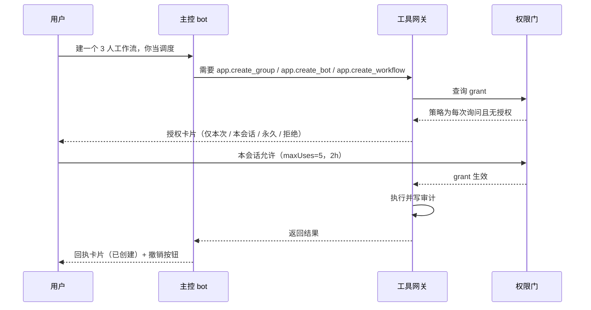

# 权限与授权

状态：D16 后端、设置页及聊天审批卡已合入 develop；本功能分支将八个应用工具接入真实聊天，并以真实 Electron、Host、钉扎 Harness 和本地受控模型验证授权后继续执行。设置页与聊天卡统一调用 `permission.*`，卡片展示已校验的精确参数，旧 `grant.create` 按钮已移除。`ask_user` 的桌面回答经受信方法 `question.list` / `question.answer` 回到等待中的工具，并写入该 bot 的用户聊天记录；回答不授予权限。`web_search` 的聊天调用由 Host 按该 bot 的 ToolPolicy.network 绑定受信句柄：allowed 才出站，disabled 拒绝，approval-required 在聊天中直接拒绝且不创建工作流运行。SearXNG 地址由受信方法 `search.config.get` / `search.config.set` 保存，显式清空优先于启动环境变量。结果经 `search.results.list` 展示，并写入该 bot 的助手聊天记录。其他工具的原生聊天 D08 审批及付费模型验收仍未完成；不能据此宣称整体平台验收。后端与运行证据见 [D16 报告](reports/D16-report.md)、[Harness 工具报告](reports/D16-harness-tools-report.md) 和 [web_search 聊天报告](reports/D16-web-search-chat-report.md)。

## 1. 三层模型

| 层 | 回答的问题 | 存在形式 |
| --- | --- | --- |
| 能力 capability | 系统允许做哪些动作 | 代码里的能力注册表 |
| 授权 grant | 某个 bot 在什么范围、多久、几次内可以使用该能力 | 数据库记录，带作用域与过期 |
| 审批 approval | 这一次操作是否放行 | 每次操作一张审批卡（D09 复用） |

模型不能修改 capability 与 grant；只有人类入口（聊天确认、设置页、撤销按钮）能产生或撤销 grant。

## 2. 能力清单

| capability | 动作 | 风险 | 默认策略 |
| --- | --- | --- | --- |
| `app.read` | 读取 bot/分组/工作流/运行现状 | 低 | 始终允许 |
| `app.create_group` | 创建分组 | 中 | 始终允许 |
| `app.create_bot` | 创建 bot（含指令与工作目录） | 中 | 始终允许 |
| `app.update_bot` | 修改 bot | 中 | 始终允许 |
| `app.create_workflow` | 创建工作流与节点/连线 | 中 | 始终允许 |
| `app.start_run` | 启动运行（消耗 API 预算） | 高 | 始终允许；策略改回询问时只接受单次审批。模型 `save_workflow` 保存成功后立即启动一次运行，不再等人按开始 |
| `app.cancel_run` | 取消运行 | 中 | 始终允许 |
| `app.dispatch_task` | 任意在册 bot 向另一个 bot 派发一段指令（触发执行者的一个聊天回合） | 中 | 不经人工批准。已保存的询问或拒绝不再生效。聊天不出现这张审批卡，也不留下「已始终允许 … 派发任务给其他 bot」的状态行。用户这句没有把事情交给其他 bot 时，这一轮的 `dispatch_task` 直接拒绝，不向人索要权限。执行者自身的本机工具仍受其各自策略约束。接力链不再因这条策略中断 |
| `app.learn_skill` | 当前 bot 在聊天里学会一条技能并在之后的回合使用 | 低 | 始终允许，不出现在设置页。人可以让 bot 自己上网找，也可以把找到的技能发给它学 |
| `app.schedule_message` | 当前 bot 在聊天里保存、列出或取消一条定时消息（到点把原文发进自己的会话） | 低 | 始终允许，不出现在设置页。人在对话里定义钟点，不另开批准 |
| `app.revoke_creation` | 撤销创建批次 | 中 | 始终允许 |
| `interaction.ask_user` | 等待人类回答 | 低 | 始终允许；回答不授予权限 |
| `fs.read` / `fs.write` | 工作目录文件读写 | 中 | 始终允许，仍受 D08 路径策略约束；已保存的拒绝优先 |
| `exec.shell` | 执行本地命令 | 高 | 每次询问；只接受单次审批，不能发会话或永久授权 |
| `screen.capture` | 窗口截图 / OCR | 高 | 从不允许（需显式开启） |
| `device.action` | 接受一次指针或按键动作；`device_input` 在另一次审批后执行一次有界输入 | 高 | 从不允许（需显式开启）；`device.action.request` 接受后只返回 id 与时间并留下一条本地记录；`device.action.input` 才调用 exec daemon |
| `connector.invoke` | 调用 Stable Diffusion 连接器 | 中 | 每次询问 |
| `mcp.call` | 调用已授权的本机 MCP 工具 | 中 | 每次询问；只接受单次审批，不能发会话或永久授权 |
| `network.search` / D08 `network.request` | web_search 向受信配置的 SearXNG 端点提交搜索 | 中 | D16 始终允许，另需 D08 网络策略放行；缺少受信权限句柄拒绝 |
| `memory.read` | 检索当前 bot 的记忆 | 低 | 始终允许，但仍必须绑定该 bot |
| `memory.write` | 写入当前 bot 的记忆 | 中 | 始终允许；模型不能删除 |

能力注册表包含未来能力，不会自动产生对应工具；新增工具必须显式绑定能力并同步本文、契约与审计字段。`create_bots_batch` 有 newGroup 时同时需要 create_bot/create_group。草案生成仅回显、不落库，属于 app.read。

v0.5 manager-orchestration（TASK_MANAGER_ORCHESTRATION.md §3.4）：新增模型工具 `save_workflow`（绑定 `app.create_workflow`）、`dispatch_task`（绑定 `app.dispatch_task`）与只读工具 `list_tasks`（绑定 `app.read`），聊天应用工具目录由八个扩至十一个。`dispatch_task` 在授权之外追加协调者三重规则并按受信 `ToolCaller.botId` 查库：调用者必须是 coordinator、目标必须同组且非自身——任何不满足在网关层返回可解释拒绝（不是 UI 隐藏），`task.dispatch` 方法层再权威重验一次。权柄不变式：manager 能做的只有"派发一段指令"；它不拥有执行者，不读其记忆，不改其配置，不能替它审批。执行者的一切工具调用仍按其自身 grant/策略审批与审计（一条派发至少产生发起者的 dispatch 审计与执行者回合内各自记录，审计双身份）。角色 `role` 没有任何模型写入口——`bot.batchCreate` 入参为 strict，未来绑定 `update_bot` 工具时必须剥离 role（写进工具定义的测试）。模型无法自授角色或授权（`permission.*` 本就不在模型注册表）。

`web_search` 先通过 D16 network.search，再通过现有 ToolPolicy.network 及 D08 精确动作授权。工具模型参数不能指定服务地址或传入权限对象；受信调用方经 ToolCallOptions.networkPermissions 绑定句柄。工作流节点仍使用真实 D08 句柄：禁止网络时不发请求，要求审批时先等真实审批。聊天回合没有工作流运行，Host 自有句柄在 allowed 时放行，disabled 时拒绝，approval-required 时以 APPROVAL_REQUIRED 失败且不发请求。网关 JSONL 存摘要；D08 本地 tool.requested 事件按已有规范保存精确搜索参数用于审批。聊天结果卡只渲染已去掉标记的文本。

`memory_search` 绑定 `memory.read`，`memory_write` 绑定 `memory.write`。两者都只使用受信 `ToolCaller.botId`，模型参数不能指定 bot。默认不跨 bot 共享，也没有共享开关。用户经受信方法 `memory.list` / `memory.write` / `memory.delete` 查看、写入和删除当前 bot 的记忆；删除是物理删除，模型目录没有删除工具。网关 JSONL 仍只存摘要。知识导入是桌面文件对话框，不接收渲染进程传入的路径，也不是模型工具。通过后仍调用 `memory.write`，隔离规则不变。只接受 `.txt` / `.md`，文件不超过 16 KiB，正文仍须放进一条 1–4000 字的记忆。

`import_attachment` 绑定 `fs.write`，模型工具 `read` 绑定 `fs.read`。`write_document` 也绑定 `fs.write`，用来覆盖工作区内的一个 `.docx` 或 `.pdf`。`edit_document` 的读取绑定 `fs.read`，其余动作绑定 `fs.write`。`find_github_skill` 绑定 `network.search`。第一次到 GitHub 查找技能并记在本机，之后读这份记录，不再访问网络。`write_presentation` 同样绑定 `fs.write`，用来按语义简报写成一个 `.pptx`。这些读写工作区的工具默认始终允许。导入只接受 Host 已经暂存的字节，模型参数不能带文件正文或 bot id。`read` 的参数只有工作区相对路径 `file_path`。审批预览不含附件正文。

`connector.*` 管理方法只对受信桌面开放，新登记连接器默认关闭。Stable Diffusion 使用 `connector_invoke`；自定义 MCP 使用独立的 `mcp.call` 能力。MCP 首版只接受无凭据的本机 HTTP(S) Streamable HTTP 端点，可带路径；localhost 固定归一化为 127.0.0.1，拒绝远程主机、URL 用户信息、查询、片段及重定向。Host 不解析或注入 MCP 凭据。

设置页通过 `connector.mcp.discover` 显式发现工具，并通过 `connector.mcp.grants.get/set` 为指定 bot 保存准确的服务 UUID 与工具名白名单。更新时复制该 bot 的 ToolPolicy 并重新绑定，不修改其他 bot 共用的默认策略；不提供通配符或自动全选。只有已启用、已授权的工具 schema 才进入本轮 Harness 目录。模型不能调用这些管理方法。

每次 MCP 调用经过网关 `mcp_call`，审批预览包含服务名称、端点、工具名和实际参数。调用绑定本轮定义、连接器配置及发现时的输入 schema；批准后重新发现并比对 schema，在真正发送 `tools/call` 前再检查 bot 白名单和 D16 审批凭据。停用、修改端点、撤销工具或审批授权、切换工具策略、归档 bot、全局禁止能力会取消相关请求。取消是尽力中止；服务已经执行的副作用不能回滚，也不自动重试。JSONL 只记录摘要，精确参数仍只存于本地审批预览。输出图片落入本地 connector-outputs，资源链接仅作为数据返回，不自动获取。

## 3. 三档策略

每个能力可设为：

| 策略 | 行为 |
| --- | --- |
| 始终允许 | 网关直接放行，仍做参数与路径校验。这项上还在等的审批，若其余能力也已放行，一并按策略通过，聊天卡片收起 |
| 每次询问 | 网关弹出审批卡，用户允许后执行 |
| 从不允许 | 网关拒绝，向模型返回可解释原因 |

默认值：机器人互发消息（`app.dispatch_task`）不进人的批准，已保存的询问或拒绝也不拦截。工作区读写与其余应用内能力始终允许。`exec.shell`、`connector.invoke`、`mcp.call` 每次询问。`screen.capture` / `device.action` 从不允许。除派发外，已写入数据库的策略行优先于这些默认值，显式 deny 仍然拒绝。`screen.capture` 与 `device.action` 不能设为始终允许。`app.start_run` / `exec.shell` / `mcp.call` / `screen.capture` / `device.action` 在策略为每次询问时不接受会话或永久授权。策略由受信 permission.policy.set 修改并持久化。主设置页列出本地命令、连接器、MCP、设备动作和屏幕采集，不列出派发，也不展示全部能力的矩阵。

策略 deny 优先于已有授权。写操作和 network.search 即使策略 allow 也须绑定有效 bot；匿名只可使用策略 allow 的读/提问。网关没有检查器、未知能力或无效身份均拒绝。

本次批准只匹配精确 invocation/参数摘要，最多一次；会话授权绑定 botId、sessionId、Host generation，默认 5 次/2 小时，可设 1–100 次/1–1440 分钟；永久授权绑定 bot，无期限或次数上限。多能力授权在一个事务中预扣次数，任何能力缺失都不扣；handler 失败不退还。执行前同步重验政策、撤销、有效期和参数摘要，不重复扣次数。Host 重启会撤销旧 once/session 授权并使未决审批过期；永久授权和策略保留。

应用审批默认等待 10 分钟，取消信号或 Host 关闭结束等待，迟到/重复/摘要不符的决定拒绝。问题回答入口不会修改授权。精确参数存于 app_approvals 供人类预览；permission_audit 与 JSONL 不保存原文，备份包含审批预览数据。

## 4. 聊天内授权



授权卡字段固定：能力列表、作用域（本次/会话/永久）、次数上限、过期时间、申请理由。当前聊天卡片列出该 bot 的 pending 审批：申请理由用工具名，能力用中文名。本会话按契约默认 5 次、2 小时；永久不限次数。`app.start_run` / `exec.shell` / `screen.capture` / `mcp.call` / `device.action` 以及没有 sessionId 的审批不提供更长授权。决定调用 `permission.approval.decide`，并带回精确 `actionDigest`。

聊天区不再提供常驻的「给这个 bot 授予一项能力」卡片（2026-10-28 裁决：该卡常驻在每个 bot 聊天里、与用户操作无关，读作无规则弹卡）。能力的给予只走两条路径：模型真实调用能力时弹出的审批卡（上面一段），以及设置页的三档策略与授权记录（撤销在授权记录里）。受信方法 `permission.grant.issue` / `permission.grant.revoke` 语义不变——一次一个能力，scope 只有 `session` 或 `permanent`，会话授权的 `sessionId` 由 Host 写成 `chat:<botId>` 并绑定当前 Host 代次、默认 5 次和 120 分钟；调用方不能自带会话、次数或期限。Host 重启时既有逻辑撤销旧的 once/session 授权。同一 bot、能力、作用域和会话上仍有效的授权被再次授予时，返回原来那一条，不延长到期时间，也不把次数清零。策略不是「每次询问」时拒绝发放：拒绝优先，始终允许也不再叠一条授权。`app.start_run` / `exec.shell` / `screen.capture` / `device.action` / `mcp.call` 不能取得会话或永久授权。发放和撤销之后，下一次工具调用仍由现有网关检查；策略改为拒绝，或授权已撤销、过期、用尽、会话或代次不符时，该能力不会执行。这两个方法不进入模型工具目录；渲染层聊天组件不再调用 `permission.grant.issue`。

## 5. 设置页

```
设置 → 电脑与权限
  需要确认的操作
    执行本地命令          [ 每次询问 ▾ ]
    调用连接器            [ 每次询问 ▾ ]
    调用 MCP 工具         [ 每次询问 ▾ ]
    设备动作              [ 从不允许 ▾ ]
    屏幕与窗口感知        [ 从不允许 ▾ ]
  授权记录：查看与撤销
```

设置页改变这几项的策略。机器人互发消息不在这一页，也不需要批准。工作区读写和其余应用内能力默认始终允许，不在这一页逐项列出。聊天内授权是临时叠加，过期回到默认。两者共用同一张 grant 表，差异在 `scope`。`permission.policy.list` 仍返回全部能力，页面只渲染这五项。本地命令、连接器和 MCP 可选始终允许、每次询问或从不允许；设备动作和屏幕采集只有每次询问和从不允许。授权记录来自 `permission.grant.list`，不把 `scope=policy` 的全局策略行当成可撤销授权；撤销调用 `permission.grant.revoke`。

同一节下面的「屏幕与窗口感知」使用同一条 `screen.capture` 策略。开关只写成每次询问或从不允许，不提供始终允许。用户先选 bot，再刷新窗口并选定一个；截图和截图并识别各自调用 `screen.request`。等待审批时，这张卡只有「仅本次」和「拒绝」。缩略图是 `screen.result.read` 返回的 JPEG data URL，识别文本按转义文本显示，两者都不写入聊天。删除要再确认一次。换 bot 或换目标窗口之后，上一次请求的响应不会写进新的面板。

设备动作使用同一套策略表里的 `device.action`。默认拒绝。改为每次询问后，受信方法 `device.action.request` 或模型工具 `device_action` 才等待一张仅本次审批。批准后的结果只有 id 和时间，并在本机留下一条记录：id、bot id、动作名（`pointer` 或 `key`）、时间。`device.action.list` 按该 bot 从新到旧列出。拒绝、把策略改回拒绝、再次使用同一张审批，或动作名不在这两组里，都不写入。未知动作名在产生审批前拒绝。这条路径不移动鼠标、不发送按键、不调用 exec daemon，也没有单独的桌面页面。主权限页保留这一行，因为设备输入停留在询问或关闭。

真实输入使用同一条策略和同一次精确审批规则，方法是 `device.action.input`，模型工具是 `device_input`。一次请求只包含一份有界输入：指针移动或点击，坐标 0–8192；或允许列表中的一个按键点按，可带 shift、ctrl、alt，不含 Windows 键。审批卡上的参数就是这份输入。通过后才调用 exec daemon。成功响应只有 id、时间和 pointer 或 key。本机 `device-outputs` 留下 JSON，可用 `device.action.input.list` 查看，列表不含路径。拒绝、停用、复用审批、未知按键，或这台系统没有输入辅助进程，都不执行。`device_input` 不进入聊天应用工具目录。没有单独的设备动作页面。

## 6. 审计与撤销

- 每次工具调用写一条审计：`at`、`botId`、`capability`、`argsDigest`、`grantId`、`decision`、`result`、`runId?`；
- 审计不可由模型写入或删除；
- 批量创建记录 `batchId`，支持一键撤销整批（回滚分组、bot、工作流）；
- 撤销 grant 立即生效，进行中的操作在下一次网关检查时终止。

## 7. 与 D08 的关系

D08 已实现：路径规范化与包含校验、策略评估、一次性审批门、MCP 授权检查、启动代次绑定。v0.2 在其上增加：

1. 新的 `app.*` 能力类别；
2. grant 表与作用域；
3. 聊天内授权卡片与设置页；
4. 审计与批量撤销。

不改变 D08 的既有语义：副作用前拦截、一次消费、重启后旧审批不可重放。

## 8. 安全红线

- 模型不能调用授权接口给自己或其它 bot 授权；
- “从不允许”必须在网关层拒绝，不能只靠 UI 隐藏；
- `app.dispatch_task` 不经人工批准，已保存的询问或拒绝不拦截。`exec.shell`、`connector.invoke`、`mcp.call` 默认每次询问。除派发外，已经保存的策略行优先于这些默认值；
- `app.start_run` 默认始终允许；策略改回每次询问时仍只接受单次审批；
- 屏幕截图/OCR 默认关闭，不能设为始终允许，采集内容不出本机；
- 设备动作默认关闭；未改为每次询问、没有一次精确的仅本次审批，或动作名不是 `pointer` / `key` 时，不接受，也不写本地记录。本片不执行输入；
- 审计与撤销记录不能由模型修改；
- 任何绕过路径（例如直接写数据库、直接调用 IPC）都视为缺陷。


## 9. 角色与派发：聊天给予，无身份牌（设计裁决，2026-10-27）

负责人裁决：**取消"协调者"身份牌模式**（角色选择器、侧栏徽标、每组至多一个协调者等一并移除）。bot 之间的身份与权限**纯靠用户在聊天里给予**，便利性优先；操控电脑类能力的硬门槛不因任何"任命"放松。

规则：

1. **默认能力**：每个 bot 的能力 = 设置页三档策略所授予的集合，无任何默认角色；
2. **聊天给予**：用户在聊天里说"你当总监 / 这事交给你"时，网关把被点名 bot 需要的**应用类能力**（创建分组、创建 bot、修改工作流、派发任务）以正式 grant 形式授予——发起引用用户消息、可审计、可撤销；应用类授予默认免确认（用户打字即授权）；
3. **红线不松动**：`screen.capture` 与设备动作默认关闭，且不能设为始终允许。`exec.shell` 默认每次询问，`app.start_run` 默认始终允许；这两项在策略为每次询问时仍不可通过聊天拿到会话或永久授权，只能逐次审批。`app.dispatch_task` 不经人工批准；
4. **模型不能自授**：授予必须由用户消息触发（网关记录发起消息引用）；bot 不得通过对话话术为其它 bot 或自己追加能力——模型只能提议（ask_user 卡片），由用户点击确认；
5. **无 UI 身份标记**：侧栏/聊天不显示角色徽标；派发关系只体现在交付通知与审计里；
6. **撤销**：用户可随时在授权记录里撤销某次聊天授予，撤销即时生效。

落点：移除 bot 表单角色选择器与侧栏徽标（编排线）；`ask_user` 卡片复用为"任命确认卡"（列出将获得的能力清单）；grant 表增加 `grantedVia: "chat" | "settings"` 标记。这些落点尚未实现。当前切片只让聊天为这个 bot 授予或撤销一项能力，并继续用现有网关检查；不新增 `grantedVia`，不移除角色选择器，也不把一句聊天话术自动变成授权。
