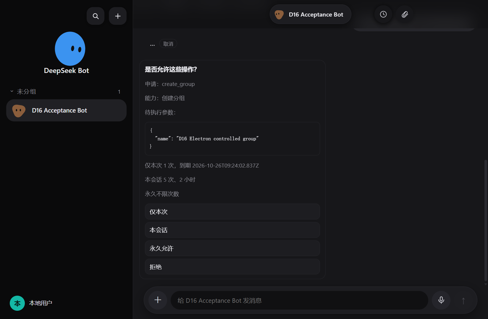
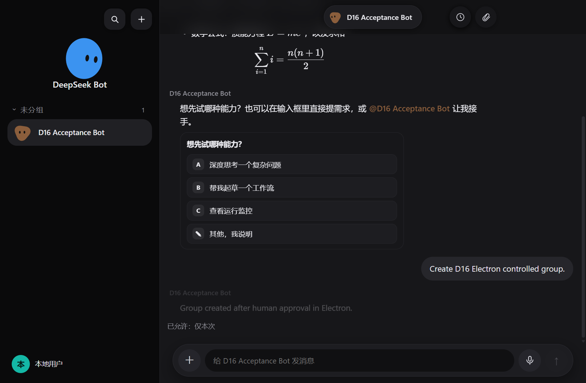

# D16 真实聊天应用工具与授权闭环

日期：2026-10-26（Asia/Shanghai）。负责人：Etheslay。分支：`feature/harness-tool-gateway`。基线：`2ecb2f94b1e79358fbe49faa6d0f3977cc23de76`，已含 PR #47/#49/#51/#50/#48。本片通过功能分支交付；本文记录本地实现与实测，不代表真人自审、远程 CI 或合并结论。自审必须针对该分支最新提交 SHA。

## 1. 交付行为

真实 Harness 的八个应用工具已进入 D15 网关与 D16 授权：`list_bots`、`list_groups`、`get_run`、`get_run_events`、`create_bot_draft`、`create_group`、`create_bots_batch`、`revoke_batch`。读工具返回真实本地数据；写工具在无数据库写入时等待精确审批，允许后原调用继续，结构化结果返回 Harness，由模型继续回答。

- 工具名称、描述和参数 JSON Schema 来自同一网关定义；Host 仍严格校验并在执行前重验。JSON Schema 不能代替后端校验，权限控制面不进入模型目录。
- 启动前在应用自有 profile 中离线准备无运行依赖的插件，重复准备跳过未变化内容；完整目录注册并回报 readiness 后才发送 prompt。缺少构建或插件加载失败明确报错。Host 构建随附插件，测试链路先构建插件，不要求用户运行包管理器。
- 离线准备完整预检安装目录及源/目标文件，拒绝符号链接和 Windows junction，不删除既有链接、不沿旧 `file:` 安装写入外部目录。用户选择的 Harness home 自身可以是 junction。
- Host 内部通道只监听 `127.0.0.1` 随机端口，每轮独立随机令牌。物理 Harness 会话由 Host 登记，绑定稳定的 `chat:<botId>` 逻辑会话和可信 bot。模型参数及公开 `tool.invoke.callerBotId` 不构成可信身份。
- 同一物理会话的 call ID 缓存进行中与已完成结果，重复请求不重复执行；同 ID 不同工具或参数拒绝。每轮最多 1000 条记录，结束时释放。请求及插件响应上限 1 MiB，不同 bot 的认证、账本与审批隔离。
- 会话授权跨聊天轮次复用，次数照常消费，重启按既有 generation 失效；永久授权和撤销沿用 D16 后端。审批默认 10 分钟，插件调用期限 11 分钟，HTTP 不设更短的响应头等待期限。
- 取消覆盖凭据解析、初始化和审批等待；断连、子进程结束与 Host 关闭清理等待，关闭服务也解绑上游取消监听器。完成清理后才释放数据库。
- 审批卡展示完整转义 JSON 参数并支持滚动，删除旧失败横幅的 `grant.create` 按钮；切换 bot 时迟到响应不能覆盖当前审批。审计继续保存摘要和授权元数据，不写入参数原文。

无新增桌面公开方法、数据库迁移、依赖或 lockfile 改动。协议仍为 0.3，迁移版本仍为 7；D17 技能 capability 声明不授予权限。

## 2. 实际检查

环境：Windows、Node v24.15.0、pnpm 11.28.5（实际检查的提升权限环境）、Electron 38.2.1、Harness `0.2.1-rc.2`。基线全仓 765 通过、1 跳过。本轮关键测试先观察失败后实现，包括通道缺失、聊天未接线、参数预览、bot 迟到响应、凭据等待取消、监听器释放和四种目录链接保护。

| 实际命令 | 结果 |
| --- | --- |
| `pnpm lint` | 退出 0 |
| `pnpm typecheck` | 全仓退出 0 |
| `pnpm test` | 全仓退出 0，794 通过、1 跳过；既有覆盖率门槛通过 |
| `pnpm --filter @deepseek-bot/harness-bridge build` | 退出 0 |
| `pnpm --filter @deepseek-bot/host build` | 退出 0，包含随附离线插件 |
| `pnpm --filter @deepseek-bot/desktop build` | 退出 0；存在第三方 Zod 的 Rollup 注释警告 |
| `pnpm --filter @deepseek-bot/host exec vitest run src/real-app-tools.test.ts` | 实际钉扎 Harness + 本地受控 Messages SSE 模型闭环通过 |
| `pnpm --dir apps/desktop exec electron scripts/accept-app-tools.cjs` | 生产 Electron main/preload/renderer + stdio Host + 钉扎 Harness + 本地受控模型通过；3 次本地模型请求 |
| `git diff --check` | 退出 0 |

最终包计数：desktop 208、shared 6、contracts 86、storage 147、agent-tools 69、runtime 128、harness-adapter 58、harness-bridge 15、host 77 通过 + 1 跳过。新增 29 项：插件 5、profile 准备 6、Host 通道 12、聊天 3、真实 Harness 1、桌面组件 2。跳过的是既有付费 API 冒烟测试，未显式启用，不计为通过。

新通道测试覆盖严格参数、错误令牌、物理会话不匹配、控制方法隔离、并发重复及参数冲突、同 call ID 的并发 bot 隔离、断连、取消、Host/服务关闭、迟到决定、审批过期、会话跨轮消费与隔离，以及无原文审计。重启失效、永久授权、撤销及期限继续由既有 D16 后端测试覆盖；桌面完整链路实际验证的是「仅本次」。

调试曾遇一次假 Harness 初始化异常退出，单独复测和最终全仓回归未复现；已补充假进程异步请求错误诊断，没有据此宣称其根因已修复。最终真实 Harness 与 Electron 验收均使用独立本地模型服务，不依赖假 Harness。

## 3. 真实桌面证据

最终 Electron 验收于 2026-10-26 17:14（Asia/Shanghai）通过。脚本在实际页面发送请求，确认真实审批卡显示精确参数、审批前数据库没有分组，然后点击实际「仅本次」按钮，验证恰好创建一个分组、工具结果进入下一次模型请求、最终回复出现在聊天页面。截图等待布局绘制，并核对审批按钮实际可见；没有把 D14 示例卡片当作验收。

复现顺序：Host build → desktop build → 上表 Electron 验收命令。脚本使用独立 Electron userData 与 Host 数据根，测试 dummy key 经生产 safeStorage 存储；临时运行数据、密文与结果 JSON 位于忽略的 `.tmp-d16-electron-*`，不修改日常应用数据，仅两张无真实凭据的截图纳入报告。

## 4. 审查与未验证边界

独立 AI 只读审查覆盖插件、认证、去重、会话、取消关闭、离线准备、构建和参数预览；发现的上游监听器释放问题已复现并修复。随后补充目录链接保护的四项失败到通过回归。AI 检查不能代替 Etheslay 真人自审。

- 未调用真实付费 DeepSeek API，未验证真实供应商的工具选择可靠性。本地模型验证的是实际运行时协议、审批和执行路径。
- 未接入 `ask_user` / `web_search` 聊天能力或新增工具；原生聊天 D08 工具审批仍待接线，原本需要审批的原生调用继续拒绝，不宣称所有原生工具均受本轮 D16 控制。
- 未执行安装包、签名、干净机、升级或远程 CI；GitHub 服务端保护规则未重新核验。开发态 Electron 不能代替发行验收。
- 后续先完成 `ask_user` 桌面回答回传，再完成 `web_search` 的受信 D08 句柄、SearXNG 配置与结果呈现，然后推进 D18。该顺序的第一项由后续 `feature/ask-user-chat` 交付，见 [ask_user 回传报告](D16-ask-user-chat-report.md)。

## 5. Etheslay 本人自审

自审人：＿＿＿＿　最新提交 SHA：＿＿＿＿　日期：＿＿＿＿

- [ ] 最新差异、权限边界与兼容性：＿＿＿＿
- [ ] 自动化检查、错误路径与截图：＿＿＿＿
- [ ] 远程 CI 和未验证边界：＿＿＿＿
- [ ] 自审结论：＿＿＿＿
