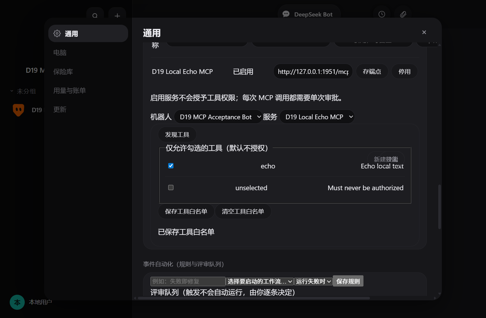
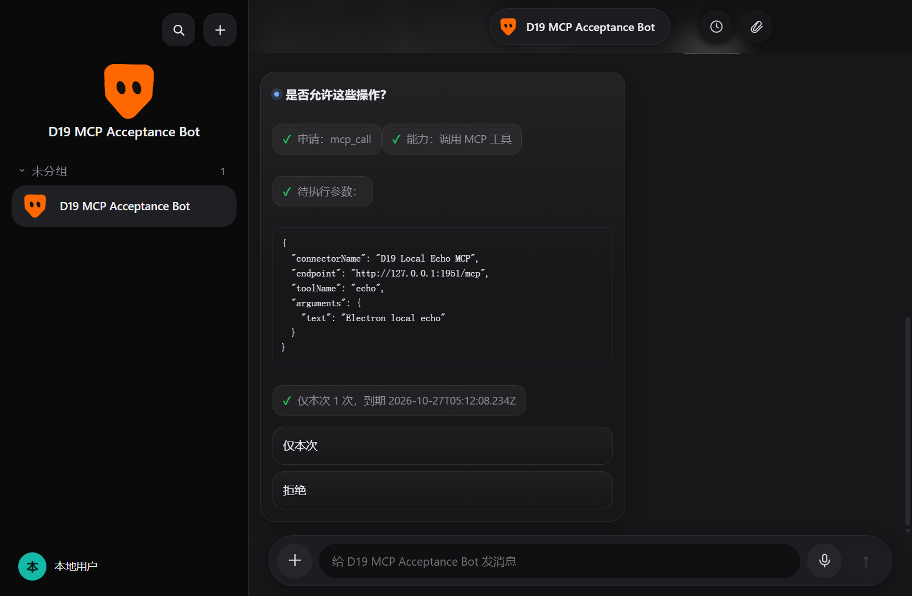
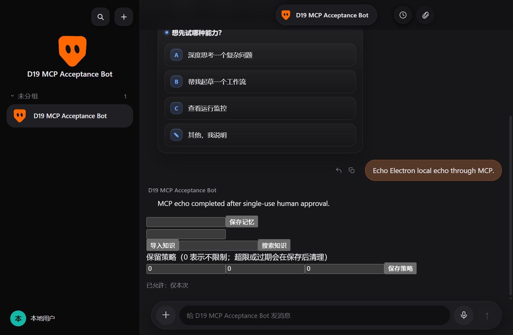

# D19 本机 HTTP MCP：发现、按 bot 授权与聊天单次审批

日期：2026-10-27（Asia/Shanghai）。负责人：Etheslay。实现分支：`feature/connectors-mcp`。开发基线为含 PR #65、#66 的 `develop`（`3afea9009c2422bf13d615cccbf9b31e184cc737`），依赖契约 PR [#67](https://github.com/Etheslay/deepseek-bot/pull/67)（`fafc4b5`）。为持续开发，实现分支暂时包含依赖提交；合并顺序必须先 #67，再实现 PR，均以 develop 为目标。本文是 AI 辅助实现与实际检查记录，**不是真人自审或合并结论**；最终提交 SHA、CI 证据与 Etheslay 自审结论在 PR 更新。

## 1. 交付行为

- 设置中可登记 `mcp-http` 服务，新建默认关闭；用户启用后显式发现工具，选择 bot、服务及准确的工具名，保存或清空白名单。未勾选的工具不会自动获准，旧授权中暂未发现的工具仍可手动移除。
- 每次授权更新复制该 bot 的 ToolPolicy 并重新绑定，保留其他共享策略使用者和已有运行快照。默认策略仍关闭 MCP；模型不能调用登记、发现或授权管理方法。
- 本轮授权目录在启动 Harness 前准备，最多四个服务并发、共用 10 秒总期限；不可用服务被省略，普通应用工具可继续工作。最多 200 个工具、目录 256 KiB；每个服务工具 schema 合计最多 64 KiB。目录绑定 bot、连接器配置、工具名与输入 schema，结束回合后释放。
- 模型获得各工具原始输入 schema 和 Host 生成的工具别名，调用统一进入 `mcp_call` 网关。Host 先校验实际参数、连接器状态和当前 bot 白名单，再申请 `mcp.call` 的精确单次审批。该能力只能 ask/deny，不能使用会话或永久授权。卡片显示服务、端点、工具名和完整实际参数，内部定义 ID 不参与界面预览。
- 批准后重新发现并比对 schema，在实际 `tools/call` 前重验当前 bot 策略和 D16 审批凭据。停用、改端点、撤销授权、切换策略、归档 bot 或全局 deny 会使相应请求失效并取消在途请求。已经被服务执行的副作用无法回滚，调用不自动重试。
- 调用成功、拒绝、取消、异常及协议内 `isError` 都写网关审计；审计只保留摘要和授权元数据。`isError` 结果仍回传模型，但审计标记 error。精确参数沿用本地审批表的预览存储。

## 2. 协议、迁移与边界

契约协议 0.5 兼容 0.1–0.4，工作流文档版本仍为 0.1。受信方法新增 `connector.mcp.discover`、`connector.mcp.grants.get`、`connector.mcp.grants.set`。固定依赖为 MCP client 2.2.0、Ajv 8.20.0、ajv-formats 3.0.1；使用 SDK 的 Streamable HTTP 发现与调用，实测服务协议版本 2025-11-25。参数 schema 支持 draft-07 / 2020-12 及标准格式；不支持的 schema、外部引用或未知格式明确拒绝。

迁移 `0014-connectors-kind` 为已有连接器补上 `sd-webui` 类型。旧 SD 登记、端点和 txt2img 行为保留，SD 调用入口明确拒绝 MCP 类型，避免绕过 MCP 白名单。已应用迁移的 SQL 和校验和均未更改。

MCP 仅接受 HTTP(S) 的 `127.0.0.1`、`[::1]` 或 localhost（固定归一化至 127.0.0.1），允许 `/mcp` 等路径，拒绝 URL 用户信息、查询、片段和所有重定向。MCP 登记拒绝非空 credentialRef，客户端不使用 OAuth、Authorization 或 Cookie，也不解析本地凭据。发现 10 秒、调用 120 秒，响应流总量最多 12 MiB；参数最多 64 KiB，文本及结构化输出最多 512 KiB。

PNG/JPEG/WebP/GIF 图片严格解码并逐张限制 8 MiB，存到 `<dataRoot>/connector-outputs/<connectorId>/`，返回本机路径；整体输出检查失败时不写图片，写入失败会清理本次已写文件。嵌入式二进制资源拒绝，资源链接只作为数据返回，不自动读取。connector-outputs 沿用 SD 的可再生成产物语义，不纳入元数据备份。

回退程序不能直接打开迁移后的数据库；应使用升级前备份恢复匹配旧版本的数据根，不手工修改迁移记录或校验和。stdio、凭据注入、视觉理解和 D21 本地执行未包含在本片。

## 3. 实际验证

环境：Windows，Node 24，pnpm 11.28.5，Electron 38.2.1，Harness 0.2.1-rc.2。Electron 自身 Node 为 22.19.0，Host 使用独立 Node 24。测试全部使用本机受控服务和公开 dummy key，没有付费模型请求。

| 检查 | 实际结果 |
| --- | --- |
| `pnpm lint` / `pnpm typecheck` | 退出 0 |
| `pnpm test` | 最终全仓退出 0：993 通过、1 跳过，全部既有覆盖率门槛通过 |
| `pnpm --filter @deepseek-bot/desktop test` | 最终 desktop 268 通过（包含新增预览测试） |
| Host / desktop build | 均退出 0；desktop 有既有第三方 Zod Rollup 注释警告 |
| `pnpm --dir apps/desktop exec electron scripts/accept-mcp.cjs` | 最终代码真实桌面验收退出 0；两个本地模型请求、一次 MCP 调用、结果进入模型继续请求 |
| `git diff --check` | 退出 0 |

最终包用例计数：shared 6、contracts 97、harness-bridge 29、agent-tools 80、storage 175、desktop 268、runtime 128、harness-adapter 58、host 152，另有 1 项既有付费 API 冒烟跳过。Host 覆盖率 89.87% statements / 84.19% branches。跳过项不计为通过。

新增测试先观察预期失败再实现。关键回归覆盖：旧库升级、共享策略隔离、端点边界、工具发现与分页、标准格式、目录与响应上限、单次审批、bot 隔离、实际参数校验、schema 变更、重复调用去重、各类撤销、异步发现到实际调用之间的授权竞态、准备阶段取消、统一目录期限、失败审计、图片落盘、最终路径计入响应预算及整体输出失败前不落盘。

独立 AI 审查发现并推动修复了异步发现后的授权竞态和标准 JSON Schema 格式问题；后续复查确认发现工作占用初始化期限，又补上启动前准备与统一期限。AI 审查不替代负责人自审。中间一次全仓运行的既有真实 Harness 初始化在 15 秒期限超时，未改生产超时来掩盖问题；最终全仓回归与真实桌面验收均通过。#67 曾有一个 push 检查因既有存储备份/迁移测试的 5 秒期限失败，同 SHA 的 PR 检查通过，失败任务重跑通过，当前两个 quality 检查均通过；后续最新远程结果以 PR 为准。

## 4. 真实桌面证据与未验证项

最后一次验收验证：通过实际设置界面发现两个工具、默认都不选中，只勾选 echo 并保存；模型只看见一个 MCP 工具，仍有原八个应用工具；实际审批卡参数正确且只有“仅本次”和“拒绝”；批准前调用数 0、批准后为 1；结果进入第二次模型请求并在聊天中显示最终回答。截图已逐张检查，无真实凭据和用户数据。

验收脚本、独立数据根和 dummy key 均与日常应用数据隔离。运行数据留在忽略目录，仓库只提交脚本和以上截图。未验证任意第三方 MCP 服务的兼容性、真实付费模型选择工具的可靠性、真实 SD 环境、发行安装包、签名、干净机或升级。GitHub 服务端保护规则本轮未重新核验，不据规范文件宣称保护已启用。

## 5. Etheslay 本人自审

自审人：＿＿＿＿　最新提交 SHA：＿＿＿＿　日期：＿＿＿＿

- [ ] 最新差异、需求、迁移与兼容性：＿＿＿＿
- [ ] 权限竞态、撤销、错误路径及自动化证据：＿＿＿＿
- [ ] 真实桌面截图、远程 CI 与未验证项：＿＿＿＿
- [ ] 自审结论：＿＿＿＿
