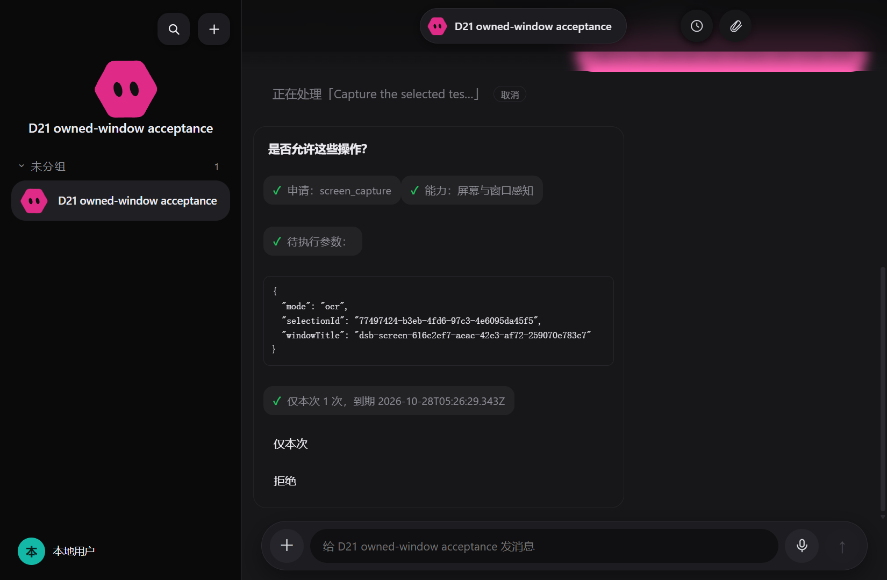
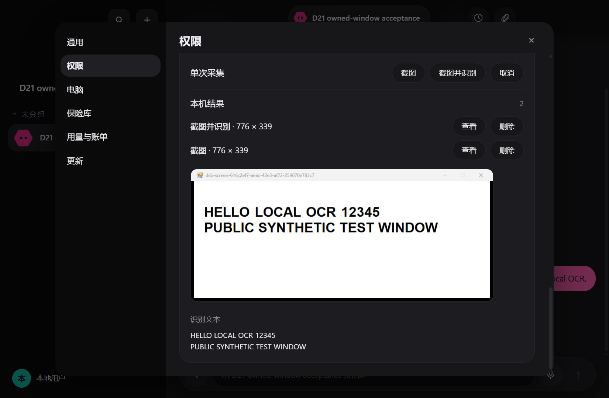

# D21 Windows 集成修复与验收

日期：2026-10-28（Asia/Shanghai）。负责人：Etheslay。分支：`feature/screen-windows-acceptance`，目标 develop。基线：`bebf27242b0a77f83e3db96b070945ca42f6eda9`（含 PR #92）。最新提交与精确检查 SHA 见本 PR 检查记录；本文由 AI 辅助记录，不代表真人自审。

## 1. 进度判断与本片范围

D21 已有 #70 契约、#74 Windows/离线 OCR、#77 Host 网关、#81 缺失助手错误和 #83 桌面设置，不再重复实现。原报告主要来自 Linux/Node 22、假后端及 jsdom，真实 Windows 和完整 Electron 路径仍缺证据。本片从最新 develop 修复并验证这些集成边界，保留默认拒绝、精确单次审批、选定窗口和内容仅在本机预览的范围。

#88/#89 的设备动作仅包含审批闸门与本地记录，不执行真实键鼠。D19 的 stdio、凭据注入与视觉理解仍留后续。旧 `feature/local-exec` 的未提交实现保留在原目录，没有整体覆盖当前 develop。下一步排期见 [实施计划](../superpowers/plans/2026-10-28-d21-windows-acceptance.md)：先 D20 新 eventRule 链路的桌面评审/状态通知，再独立处理聊天授予权限与现有角色实现的差异；避开在途 #91。

## 2. 复现与修复

- **分发资源**：Host build 现在把固定 win32-capture.ps1 与 worker/core/WASM/英中语言包、许可一起放进 `dist/screen-assets/`，随既有 Electron extraResources 复制。构建后明确使用该目录，源码运行使用 exec-daemon 的源码助手和 dist/ocr；不再要求安装机器能解析 exec-daemon 工作区包。独立临时目录中的 Host 启动/受信调用测试通过；Harness 仍使用既有外部运行时，不据此宣称完整安装包独立可用。
- **OCR bundle**：复制的上游核心 .js 需要 CommonJS，资源目录增加明确模块范围；固定布局改为静态 JSON 导入，避免 bundle 启动后再读取不存在的源码 JSON。两种问题均先观察失败，再用仓库外真实中英 OCR 验证通过；无网络回退。
- **取消和结果一致性**：清单写入完成后再次核验授权、取消和目标；失效只回滚本次结果，保留此前记录。按 bot 串行更新发布/删除，避免互相覆盖。即使清单回滚遇到写入故障，也清理本次截图；读取清单时忽略已不存在的结果目录，下一次成功变更会修复清单中的失效元数据。
- **目录边界**：拒绝 screen-outputs 根目录或 bot 输出目录的 junction/符号链接，避免截图写进工作区或其它目录；整个数据根使用目录别名的兼容用例保留。Windows 安全测试使用 junction，保留链接拒绝断言，不依赖管理员文件 symlink 权限。
- **私有 HTTP 端口**：本机动态 TCP 范围实测为 1024–15000，原 `listen(0)` 可得到 Fetch 禁止的端口并导致真实请求报 bad port。审批桥与应用工具通道共用高位随机端口分配，仍只监听 127.0.0.1，碰撞/保留端口最多尝试 16 次，保留原认证。相关规则来源为 [Fetch 的端口限制](https://fetch.spec.whatwg.org/#port-blocking)。不修改系统端口配置。
- **关闭资源**：Host 关闭数据库后等待既有 `engine.abandonInflight()`，释放自有工作流子进程及 Windows cwd 占用；保持下次启动恢复 interrupted 的语义。挂起假 Harness 的失败复现与恢复回归通过。事件规则测试明确注入假 Harness，避免无意使用真实模型服务。

生产 UI、权限策略语义、协议版本、SQL 迁移、依赖清单和锁文件均未改动。没有任意 shell、真实设备输入、整屏回退或 OCR 内容发送功能。`SPRINTS.md` §11 八项 UI 冻结基线保持现有实现。

## 3. 实际本机检查

环境：Windows，系统 Node **24.15.0**，pnpm **11.28.5**，Electron **38.2.1**（内置 Node **22.19.0**），Harness **0.2.1-rc.2**。使用独立数据根、自建可见 WinForms 窗口、本机受控模型服务与 dummy key，没有付费模型请求。

| 检查 | 实际结果 |
| --- | --- |
| `pnpm install --frozen-lockfile` | 退出 0，未改锁文件 |
| `pnpm lint` | 最终退出 0 |
| `pnpm typecheck` | 最终退出 0，全部工作区 |
| `$env:DSB_REQUIRE_REAL_SCREEN='1'; pnpm -r --workspace-concurrency=1 --if-present run test --pool=threads --maxWorkers=2` | PowerShell，退出 0，1374 通过、2 跳过，所有覆盖率门槛通过 |
| Host / desktop build | 最终均退出 0；desktop build 是 electron-vite，不是 NSIS 安装验证 |
| `pnpm --dir apps/desktop exec electron scripts/accept-screen.cjs` | 真实链路通过，10 个检查点为 true，两个本地模型请求，错误列表为空；最终证据见本 PR 检查记录 |
| `git diff --check` | 退出 0 |

逐包通过数：contracts 132、exec-daemon 29、harness-bridge 30、shared 6、desktop 464、agent-tools 124、storage 197、runtime 137、harness-adapter 61、host 194。跳过项分别是 Windows 上不适用的“无法启动 powershell.exe”非 Windows 场景，以及没有真实 Key 的付费 API 冒烟；真实窗口采集必须执行，不能跳过。Host statements/lines 为 88.42%，branches 为 80.51%。

默认并行 `pnpm test` 的中间失败真实保留：先发现并修复链接夹具权限、HTTP bad port 和关闭后目录占用；最终代码的默认 forks 运行另出现 `ERR_IPC_CHANNEL_CLOSED`，没有把它记录为通过，也没有降低门槛。最终改用逐包串行、每包两个线程 worker 执行同一套脚本、用例及覆盖率，完整退出 0。已有 React act 警告和 Tesseract Parameter not found 诊断仍出现，没有将其描述为零警告。

一次中间 Electron 验收在 Harness initialize 的既有 15 秒期限超时，未增加生产期限掩盖它。独立握手在 Node 24.15 和 24.22 上成功，后续真实链路通过；没有据单次失败宣称版本不兼容。

## 4. 真实桌面证据

验收先核对自建窗口的随机标题、PID、HWND 与进程创建时间，只选择该窗口。覆盖默认 deny、并发请求拒绝、拒绝/取消/停用不生成截图、批准后 JPEG、本地 OCR、模型严格六字段元数据、审计不含正文、确认删除，以及窗口关闭后拒绝。脚本截图只来自隔离应用的 renderer，正文只是公开合成测试文本。

以下两图来自最终源码构建后、2026-10-28 13:16（Asia/Shanghai）的同一次成功验收，均逐张查看。该次结果为 10 个检查点全部 true、两个本地模型请求、错误列表为空、进程退出 0。运行数据、dummy key、截图原目录和本机日志留在忽略的 `.tmp*` 中，仓库只提交两张合成证据图。

## 5. 未验证与后续

GitHub 最新基线的 quality 显示 failure，但该 job 的 steps 为空，annotation 指向支付/额度限制，没有执行代码检查。用户明确要求本机验证后提交 PR。本片不重跑付费远程检查、不修改保护规则，不将缺席的 Actions 记为通过。

未做真实付费 DeepSeek、真实键鼠、NSIS 安装、签名、干净机、升级/卸载、非 Windows 运行或任意第三方 GPU/受保护窗口兼容性验证。PrintWindow 仍可能因目标应用实现而失败，不保证所有窗口可采集。GitHub 服务端保护规则未重新核验。真实设备动作与 D13/D23 发布验收继续独立排期。

## 6. Etheslay 本人自审

自审人：＿＿＿＿　最新提交 SHA：＿＿＿＿　日期：＿＿＿＿

- [ ] 最新差异、分发资源、兼容性与 UI 冻结基线：＿＿＿＿
- [ ] 单次审批、撤销/取消、异常恢复、产物隔离、关闭资源：＿＿＿＿
- [ ] 本机全量检查、真实桌面证据、远程 CI 阻碍与未验证项：＿＿＿＿
- [ ] 自审结论：＿＿＿＿
